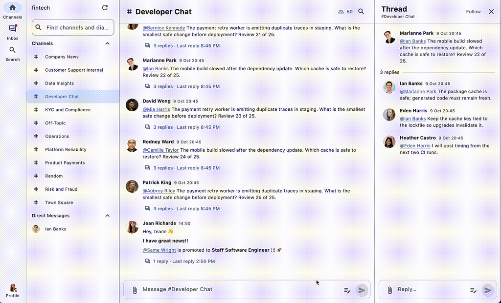
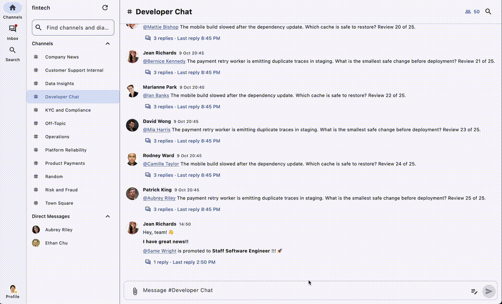
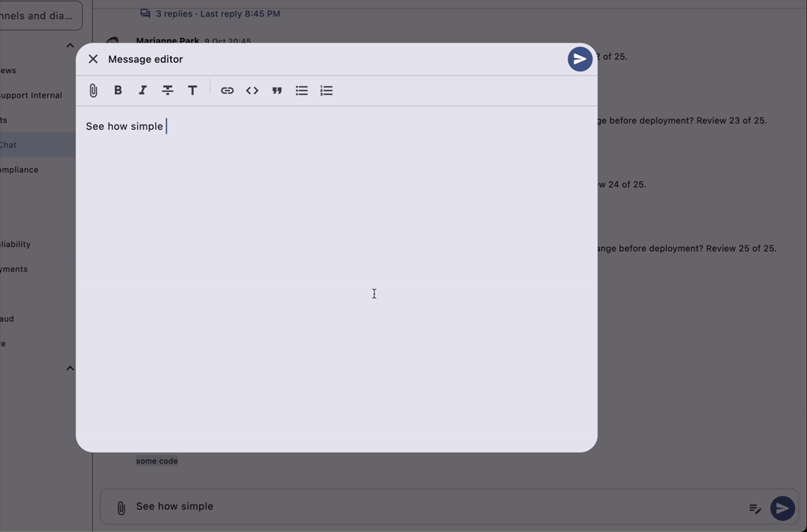

# Mattermost X


> A fast, modern Mattermost client for Android, iOS, Web, macOS, and Windows written in Flutter + Dart

One client for every screen, built for busy Mattermost workdays.

[](https://github.com/ankulikov/mattermost-flutter-client/actions/workflows/ci.yml)
[](https://github.com/ankulikov/mattermost-flutter-client/actions/workflows/release.yml)


## ✨ What sets it apart

- 📱 One codebase, every screen. The interface adapts to compact, medium,
  and expanded widths instead of treating mobile and desktop as separate apps.
- ⚡ Fast by design. GPU-rendered UI, asynchronous data loading, and
  background work keep the UI isolate free from blocking I/O and heavy tasks.
- 📥 One Inbox. Mentions, direct messages, integration posts, and unread
  followed threads share a single action queue that the official client does
  not provide.
- ⏰ A queue for later. Postpone a message without losing it in the unread
  pile, then finish or remove it when you are ready.
- ✍️ Live Markdown editing. Write in a source-preserving live preview, or
  switch to article mode for a full editor with every formatting control.
- 💬 Select and quote. Select message text and insert it into the composer
  as a properly formatted quote.
- 🔗 Links stay in context. Message permalinks open the right channel or
  thread inside the app. Back returns to the original scroll position, focus,
  and draft.
- 🟢 Everyday status presets. Set meeting, lunch, commute, or vacation
  status in one click, with optional expiration where Mattermost supports it.

## 🧰 Also included

- 🧭 Searchable sidebar for channels, direct messages, and group messages
- 🔎 Message search with channel and author filters
- 😄 Emoji and custom-emoji autocomplete
- 👉 User and user-group mention suggestions
- 👤 User profile cards with authenticated avatars
- 🛰️ Real-time updates for messages, edits, deletions, reactions, and threads
- ⚡️️ Quick context actions for mouse, trackpad, touch, and keyboard workflows
- 🔐 Password and personal access token sign-in, plus SSO on supported native
  platforms, with tokens kept in secure platform storage
- 📎 Retryable uploads, authenticated previews, and original-file downloads
- 🧩 Initial support for legacy interactive messages, including buttons and
  select menus

## 🎬 See it in action

<details>
    <summary>View posts and threads</summary>



</details>

<details>
    <summary>Inbox</summary>
    


</details>

<details>
    <summary>Live Markdown editor</summary>



</details>

## 🗺️ Backlog

- 🔖 Saved messages ("bookmarks")
- 🤔 Message drafts (started, but not sent yet)
- 🔔 Push notifications
- 🏢 Multiple teams per account
- 🧩 Full cover of interactive messages and dialogs

## 🚧 Out of scope

- 🛡️ System Console: use the stock Mattermost web client for administration.
- 🧱 Third-party apps: products such as Mattermost Boards are not planned.
- 🔌 Plugins: support is TBD.

## 🤝 Contributing

1. 🧰 Install Android Studio and enable its Flutter and Dart plugins. This project
   requires Flutter 3.38 or newer and Dart 3.10 or newer; the constraints live
   in `pubspec.yaml`.
2. 🤖 Follow Flutter's [AI development setup](https://docs.flutter.dev/ai/get-started).
3. 🛠️ Read [AGENTS.md](AGENTS.md) and the relevant
   [feature document](docs/features/readme.md), then implement the change and
   cover it with tests. If you use a coding agent, make sure it uses the
   installed Dart or Flutter skill that matches the task.
4. ✅ Run the checks below, prepare a focused pull request, and explain any new
   runtime dependency.
5. 👀 Submit the pull request and wait for review.

Set up the project:

```sh
flutter pub get
dart run build_runner build
flutter run
```

Before opening a pull request:

```sh
dart format --output=none --set-exit-if-changed lib test tool
dart analyze
flutter analyze
flutter test
```

iOS and macOS builds require macOS and Xcode. Windows builds require Windows.
Android release signing and CI artifacts are covered in the
[release guide](docs/RELEASES.md).

## 📚 Documentation

- [Architecture and feature guide](docs/features/readme.md)
- [Release builds](docs/RELEASES.md)
- [Instructions for coding agents](AGENTS.md)
